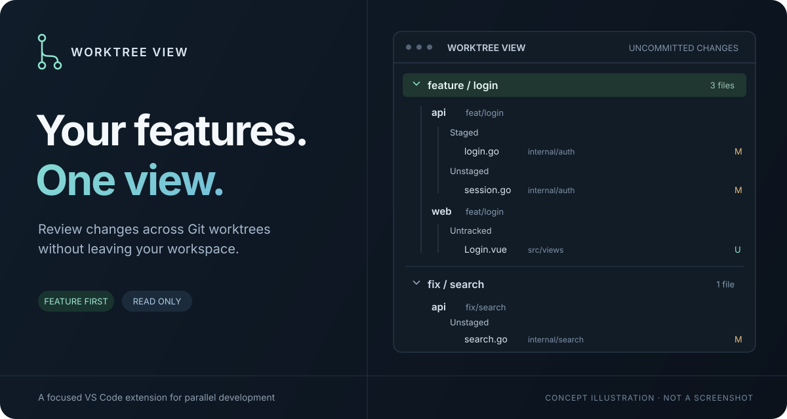

<div align="center">

# Worktree View

### Your features. One view.

Review uncommitted changes across Git worktrees, grouped by feature, inside VS Code.

**[Get started](#get-started)** · [中文](README.md) · [User guide · 中文](docs/usage.md) · [Contributing](CONTRIBUTING.md)

VS Code 1.96+ &nbsp; / &nbsp; Read-only workflow &nbsp; / &nbsp; MIT License

</div>



<p align="center"><sub>Concept illustration, not a screenshot. The extension UI is currently in Chinese.</sub></p>

## Keep parallel work in view

One feature touches both the API and the web app. Another fix lives in a separate worktree. During review, the question is simple: **what changed for this feature?**

Worktree View brings those worktrees together. Expand a feature, inspect each repository, then open a native VS Code diff—all in your current window.

```text
Feature → Worktree repository → Staged / Unstaged / Untracked / Conflicts → Files
```

Your workspace folders, Explorer and native Changes stay in place. Main checkouts are discovery seeds only; their changes remain in native Changes.

## Discover. Organize. Review.

| Find your worktrees | Group work by feature | Review with familiar tools |
| :--- | :--- | :--- |
| Discover linked worktrees from Git's registry, including external locations. | Recognize common layouts or create custom groups for scattered worktrees. | Use your file icon theme, Git status colors and native diffs while preserving unsaved edits. |

- **Separate change states.** Staged and unstaged content use different comparisons; each file counts once in totals.
- **Stay up to date.** Event-driven refresh with a default 15-second fallback while the view is visible.
- **Keep review read-only.** No automatic staging, commits, branch switching, fetching or worktree deletion.
- **Keep the runtime small.** No runtime npm dependencies or built-in telemetry. Snapshot metadata stays local.

## Get started

Requires **VS Code 1.96+, Git and a trusted workspace**. End users do not need Node.js or npm.

### 1. Install

Extract an installation ZIP and use the appropriate entry point:

| Platform | Installation | Validation |
| :--- | :--- | :--- |
| macOS | Double-click `install.command` | Tested locally |
| Windows | Double-click `install.cmd` | Not yet platform-tested |
| Linux | Run `sh install.sh` | Not yet platform-tested |
| Desktop VS Code | Extensions → **Install from VSIX** | Choose the intended profile or remote window |

**Installation assets: [GitHub Releases](https://github.com/gisard/worktree-view/releases).**

When migrating from the extension’s previous name, uninstall the old extension before installing `local-tools.worktree-view`. Rename your configuration keys to `worktreeView.*` and configure custom groups, filters, and manually selected directories again. Close old diff tabs and reopen them.

### 2. Open the view

Open your project and run **`worktree 视图: 打开视图`** from the command palette, or select the first-run notification's button. Linked worktrees load automatically.

After upgrading, use **Developer: Reload Window** if an existing window still runs the older version.

### 3. Review a feature

Expand a feature and repository, then click a file to open its diff. Filter by feature name or show only changed features. Use **归入自定义功能组** in the view menu to group worktrees whose directory layout does not describe their relationship.

## Fit your layout

**Single repository:** `.worktrees/<branch>`. **Cross-repository feature:** `.worktrees/<feature>/<repository>`.

```text
project/                            workspace/
├── .git/                           ├── api/
└── .worktrees/                     ├── web/
    ├── feat/login/                 └── .worktrees/
    └── fix/search/                     └── feature-login/
                                            ├── api/
                                            └── web/
```

Worktrees can live elsewhere, too. Once a related repository is discoverable from the workspace, Git's registry provides its linked worktrees. External worktrees appear separately by default and can be grouped manually. **Matching branch names across repositories do not imply a shared feature.**

## Know the boundaries

This is a **macOS-first 0.x preview**.

- Shows uncommitted changes in linked worktrees, not ordinary main checkouts or committed differences against a base branch.
- Windows, Linux and Remote SSH / WSL / container environments have not received full validation. Browser-based VS Code is not supported.
- Submodule internals, symbolic links and some binary formats do not have normal text diffs.
- Automatic grouping follows directory conventions; use custom groups where that convention does not fit.

See the [user guide · 中文](docs/usage.md) for limits, snapshots, error handling and configuration, and [SECURITY](SECURITY.md) for local storage behavior.

## Build and contribute

Use Node.js 22, npm and Git. ZIP packaging requires `zip` on macOS/Linux.

```sh
npm ci --ignore-scripts
npm run check
npm test
npm run bundle
```

Installation bundles are written to `release/`. Press F5 to launch an extension development window. See [CONTRIBUTING](CONTRIBUTING.md) for validation requirements and [Actions](https://github.com/gisard/worktree-view/actions) for actual CI results.

Share reproducible issues and use cases in [Issues](https://github.com/gisard/worktree-view/issues). Source reuse is covered by the [MIT License](LICENSE); internal modules are not a stable public npm API.

---

[User guide · 中文](docs/usage.md) · [Changelog](CHANGELOG.md) · [Release process](docs/releasing.md) · [MIT License](LICENSE)
