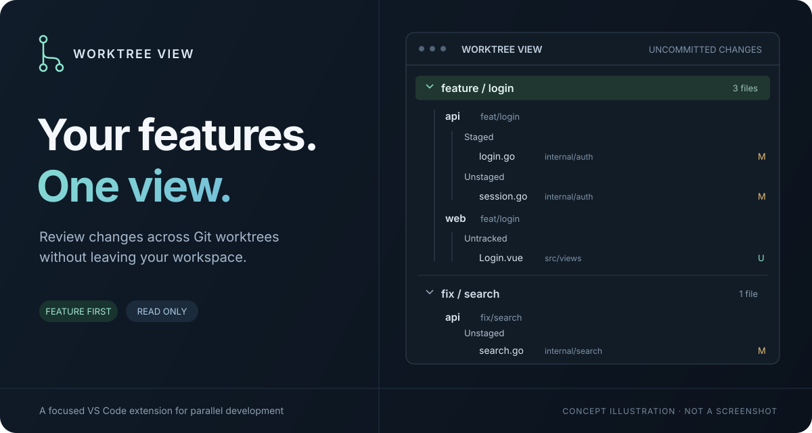

<div align="center">

# Worktree View

### 多个功能，多个仓库，一个视图。

在 VS Code 中按功能审查 Git worktree 的未提交改动。

**[开始使用](#开始使用)** · [使用手册](docs/usage.md) · [English](README.en.md) · [参与贡献](CONTRIBUTING.md)

VS Code 1.96+ &nbsp; / &nbsp; 只读工作流 &nbsp; / &nbsp; MIT License

</div>



<p align="center"><sub>功能分组示意，非实际截图；插件当前界面以中文为主。</sub></p>

## 为并行开发留出一个清晰的视图

一个功能同时改了 API 和前端，另一个修复又开着独立 worktree。审查时，你想知道的是：**这个功能，究竟改了哪些文件？**

Worktree View 把同一功能下的 worktree 放在一起。展开功能，看各仓库的改动，点击文件打开 VS Code 原生 diff。整个过程都在当前窗口里完成。

```text
功能 → worktree 仓库 → 已暂存 / 未暂存 / 未跟踪 / 冲突 → 文件
```

现有工作区、资源管理器和原生 Changes 保持原样。主工作区只用于发现关联 worktree，普通仓库的改动继续由原生 Changes 展示。

## 从发现到审查

| 自动找到工作树 | 按功能组织改动 | 用熟悉的方式审查 |
| :--- | :--- | :--- |
| 打开关联仓库，从 Git 登记发现 worktree，支持外部目录。 | 识别常见目录布局，也可以将分散的 worktree 归入自定义组。 | 文件主题图标、Git 状态颜色、原生 diff，保留未保存编辑。 |

- **状态分得清。** 暂存与未暂存分别比较；同一文件在总数中只计一次。
- **外部操作能跟上。** 事件触发刷新，视图可见时默认每 15 秒补偿检查。
- **查看过程只读。** 不自动暂存、提交、切分支、fetch 或删除 worktree。
- **运行轻量。** 没有运行时 npm 依赖，没有内置遥测。快照元数据保存在本地。

## 开始使用

需要 **VS Code 1.96+、Git 和可信工作区**。普通用户不需要 Node.js/npm。

### 1. 安装插件

拿到安装 ZIP 后，解压并运行对应入口：

| 平台 | 安装方式 | 验证范围 |
| :--- | :--- | :--- |
| macOS | 双击 `install.command` | 已在本机验证 |
| Windows | 双击 `install.cmd` | 尚未真机验证 |
| Linux | 执行 `sh install.sh` | 尚未真机验证 |
| 通用方式 | VS Code → Extensions → **从 VSIX 安装** | 多 Profile、远程窗口请选择目标环境 |

**安装包入口：[GitHub Releases](https://github.com/gisard/worktree-view/releases)。**

从更名前的旧版迁移时，请先卸载旧扩展，再安装 `local-tools.worktree-view`；将旧配置项改为 `worktreeView.*`，并重新设置自定义分组、筛选和手动选择的目录。旧版 diff 标签页请关闭后重新打开。

### 2. 打开视图

打开项目，在命令面板运行 **`worktree 视图: 打开视图`**，或点击首次激活提示中的“打开视图”。

关联 worktree 会自动加载。升级后旧窗口如仍运行旧版本，执行 **Developer: Reload Window**。

### 3. 按功能审查

展开功能与仓库，点击文件查看 diff。用顶部搜索筛选功能，或切换“只看有改动的功能”。目录关系不明确时，在菜单中选择 **归入自定义功能组**。

## 适应你的 worktree 布局

**单仓库：** `.worktrees/<分支>`。**跨仓功能：** `.worktrees/<功能>/<仓库>`。

```text
project/                            workspace/
├── .git/                           ├── api/
└── .worktrees/                     ├── web/
    ├── feat/login/                 └── .worktrees/
    └── fix/search/                     └── feature-login/
                                            ├── api/
                                            └── web/
```

worktree 也可以放在其他位置。只要当前工作区能够发现关联仓库，插件就能通过 Git 登记找到它们；独立放置的 worktree 默认分别展示，可手动归组。**不同仓库的同名分支不会被自动视为同一功能。**

自定义父目录、分组判定和发现范围见[使用手册](docs/usage.md)。

## 使用边界

当前为 **0.x 测试阶段，macOS 优先**。

- 展示 **linked worktree 的未提交改动**；不展示普通主工作区，也不统计相对主线的已提交差异。
- 尚未完整验证 Windows、Linux 和 Remote SSH / WSL / 容器环境；不支持浏览器版 VS Code。
- 子模块内部、符号链接及部分二进制不提供普通文本 diff。
- 自动分组遵循目录约定，不能推断所有团队的任务关系；特殊布局可用自定义分组调整。

完整限制、快照恢复、失败状态和配置见[使用手册](docs/usage.md)，本地存储说明见[安全与数据说明](SECURITY.md)。

## 开发与贡献

开发环境：Node.js 22、npm、Git；macOS/Linux 打 ZIP 需要系统 `zip`。

```sh
npm ci --ignore-scripts
npm run check
npm test
npm run bundle
```

安装产物位于 `release/`，按 F5 可启动扩展开发窗口。贡献流程与验证要求见 [CONTRIBUTING](CONTRIBUTING.md)，实际 CI 结果见 [Actions](https://github.com/gisard/worktree-view/actions)。

欢迎通过 [Issues](https://github.com/gisard/worktree-view/issues) 提交可复现的问题或使用场景。复用源码时保留 [MIT License](LICENSE) 要求的声明；当前未提供稳定的 npm API。

---

[使用手册](docs/usage.md) · [更新记录](CHANGELOG.md) · [发布流程](docs/releasing.md) · [MIT License](LICENSE)
